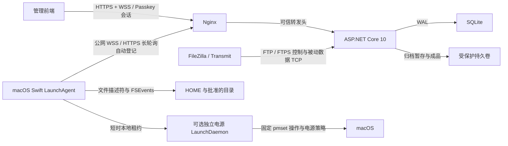

# FileSharing Milestone 1 架构

## 拓扑



服务端按身份认证、终端连接、设备策略、文件授权与操作、传输、事件、FTP 监听器分层。SQLite 单实例事务保护设备登记容量、Passkey 更新、文件授权、账号版本和任务元数据。FTPS 监听器随 ASP.NET Core 进程启动，与 REST 处理器共享目录授权和数据中继。

## 身份与授权

| 主体 | 身份 | 授权 |
| --- | --- | --- |
| 管理员 | 使用部署随机密钥首次注册单一 Passkey。验证用户在场和本机用户验证后签发 HttpOnly 会话。 | 会话空闲 30 分钟、绝对 8 小时。上锁撤销当前会话，恢复 Passkey 原子替换凭证并撤销所有管理会话。 |
| Mac | 安装包内置 HTTPS 地址。本机首次启动产生并保存 UUID。来自公网的 Agent 可自行连接并即时登记。 | UUID 是设备记录索引。有效连接独占该 UUID，远程操作授权由管理员绑定到当前连接。并发登记容量由部署配置决定。 |
| FTP 客户端 | 独立账号、加盐 PBKDF2 口令和专用监听模式。 | 每个账号显式选择已授权的根，按账号修订号核验。后台锁定期间继续工作。 |

默认共享根是当前受管账户的 HOME，由 Agent 在首次接入声明、服务端创建一次。受管包可以在构建时批准 HOME 写入。额外企业目录由 IT 在本机设定、管理端授予访问。设备端强制本地范围与读写上限，服务端在每次文件请求和每个下载块重新验证根授权及当前连接。HOME 系统隐私目录、常见凭据目录和 Agent 工作区从列表中排除，受保护 macOS 文件夹按真实文件系统权限与 TCC 状态访问。

Agent 使用 `openat`、`fstatat`、`renameatx_np` 和 `unlinkat` 逐级处理路径，校验根 inode 和设备号，拒绝穿越 symlink 和跨挂载点递归，拒绝读取硬链接目标。写操作使用客户端先前取得的版本防止误改，移动默认不覆盖。永久清除非空目录需要显式递归标志。文件操作请求、完成、设备接入和权限变更保留审计。

## 通信协议

1. Agent 首次启动在本机生成 UUID。连接 `GET /agent/v1/ws`，发送 `{"type":"hello","deviceId":"<UUID>","name":"<设备名>"}`。服务端自动登记、标记在线并回应 `{type:"ready",deviceId}`。握手可直接从公网发起，接入受部署容量及入站速率限制。
2. 已知 UUID 重连时继续使用原设备记录。设备活跃时重复 UUID 返回 `device_already_connected`。设备被注销时返回 `device_revoked`。设备上报身份和名称来自客户端自报，管理员在开启远程操作前根据现场环境确认连接。
3. WSS 上服务端推送 `policy`、`ping` 和 `command`，Agent 回发 `pong`、`event` 和 `result`。服务端按 `command.id` 匹配结果，超时和设备离线按标准错误映射。
4. WSS 暂时不可用时，Agent 向 `POST /agent/v1/connect` 发送同一份 UUID 和名称，自动获得当前 HTTPS 传输通道号。随后在 `X-FileSharing-Channel` 携带通道号，调用 `GET /agent/v1/commands` 长轮询约 20 秒、`POST /agent/v1/frames` 批量回送 `{frames:[...]}`，或用 `GET /agent/v1/policy`、`POST /agent/v1/pulse` 同步策略和 RTT。通道号只在该次连接期存于内存。Agent 感知接口、可达性和代理指纹变化，重连优先尝试 WSS，故障重试采用带抖动的指数退避。
5. 管理后台使用 `PUT /api/v1/devices/{id}/connection-access` 开启或停用当前连接的文件与远程操作。连接关闭、超时或服务重启时该授权结束。设备 UUID、别名、策略和根目录授权保存在原记录中。服务器把命令、进行中的归档、下载和目录监听绑定到各自活跃连接。
6. 指标用 `event` 帧推送，快照及分页历史落 SQLite。CPU 与内存默认手动刷新，高频采样可单独设为 5–3600 秒。应用生命周期和磁盘连接走系统通知，已安装应用用扫描对账。网络变化与电源信息按事件和低频采样同步。

```json
{"type":"command","id":"0e2706c0-30f8-44dd-8a7a-8f6fce9c5585","kind":"files.stat","payload":{"root":"8a98c55a-bb1c-49ef-8c59-4af48f0cde53","path":"plan.pdf","summary":false}}
```

Agent 返回 `{type:"result",id,ok:true,payload}` 或 `{type:"result",id,ok:false,code}`。遥测帧为 `{type:"event",id,topic,snapshot,payload}`。WSS 的收到确认使用 `{type:"ack",id}`。带网络中断的结果可能未知，修改请求返回设备超时时，前端应重新读取目标状态和版本。

## 目录监听与数据中继

- 前端先订阅 `files.changed`，收到确认后向 REST 拉取目录快照。服务端引用计数复用同一设备、根、相对路径的监听，定期续费 Agent 侧租约。Agent 每台最多四个观察目录。
- FSEvents 通知触发有界目录对账。采用本地设备号及 inode 匹配同批次的单一重命名，输出 `fromPath` 和新元数据。系统标记丢失事件或变化批过大时请求重读快照。监听器无订阅后释放。
- 单文件通过 256 KiB 源文件块中继，可按强 ETag 和字节 Range 断点续传。服务端通过背压限制并发，逐块验证文件版本；写入目标通过暂存和提交保护已存在文件。
- ZIP 作业遍历同一个已授权根中的选中项目，将逐块抵达服务端的文件写入服务端 `.part` 归档。归档完成后同盘改名发布，管理 API 提供需要当前会话的下载 URL。支持多选、隐藏项、空目录和 ZIP64。作业及并发有配额。
- FTP 的虚拟根列出账号拥有目录授权、当前连接已开放远程访问的在线设备 UUID。进入设备后列出根授权 ID。FTP 数据连接由服务端被动监听，`LIST`、`MLSD`、`MLST`、`SIZE`、`MDTM` 与 `RETR` 映射到相同文件能力。 `REST STREAM` 按源版本校验已知续传记录。第三方客户端可递归下载文件夹。管理 API 提供文件写操作。

## macOS 约束

Agent 在 Aqua 用户会话内运行，锁屏期间仍在该会话。FileVault 预启动状态与用户注销期间由 macOS 管理。文件夹权限请求通过本机原生文件访问触发可能的系统提示，结果包括最近观测时间和设置页。Input Monitoring 提供状态和本机设置引导。Pasteboard 通过原生 API 发起一次权限探测，丢弃读操作的返回值，消息仅携带 macOS 授权状态。应用清单读取和权限探测在工作队列执行，长轮询心跳独立于首次遥测收集。诊断目录限定 `osVersion`、`uptime`、`diskSpace` 和 `agentHealth`。

电源辅助服务依据当前连接获准执行的 Agent 策略租约、AC 电源、至少 40% 电池、低电量模式和热状态执行。它仅管理自己取得的 `SleepDisabled` 设置，租约失效时恢复，并在重启时检查恢复标记。用户态 IOKit 断言处理防空闲睡眠。显示器、屏保及锁屏密码由 macOS 或 MDM 控制。硬件合盖行为仍须在目标 Mac 验收。设计参考 [Capsomnia 的电源实现说明](https://github.com/fuji-mak/Capsomnia#security) 与 [Apple 的 IOKit 断言说明](https://developer.apple.com/documentation/iokit/kiopmassertiontypepreventuseridlesystemsleep)。

## 持久化与运行限制

SQLite 使用 WAL。事件保留 30 天并限制约 25 万条，目录变更事件保留 15 分钟，审计保留 90 天，ZIP 产物保留 24 小时。传输超过 64 GiB 或归档超过 10 万条目会拒绝。单目录扫描上限 5 万子项，分页每次最多 200 条。文件与任务状态的历史均以服务端时钟为准。SQLite 配置和内存中的连接中枢适用于单实例部署。
